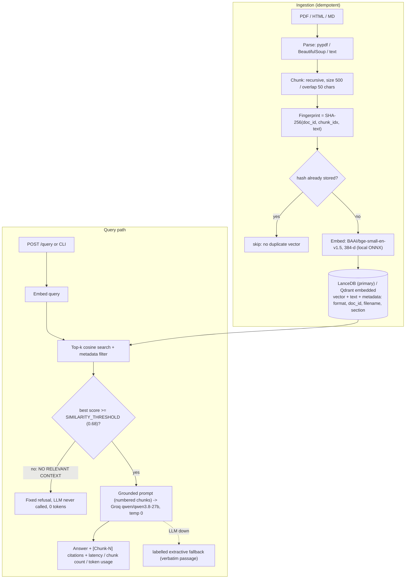

# Cost-Efficient RAG Service (Take-Home, Problem 1)

A QA service over PDF / HTML / Markdown, backed by **LanceDB** (embedded, no always-on server), with **embedded Qdrant** benchmarked as the second store. Retrieval and answers are evaluated on a fixed 30-question set, and the monthly cost is compared with managed vector databases at 100K / 1M / 10M vectors.

| | |
|---|---|
| Frontend (Vercel) | https://synergylabs-lilac.vercel.app/ |
| Backend API (Render, free tier) | https://cost-efficient-rag-service.onrender.com (`/docs`, `/health`) |
| Code | https://github.com/Mohityadav55199/SynergyLabs_Assignment |
| Operating it | [HANDOVER.md](HANDOVER.md): ownership, deploy, access, runbook, known limitations |

> Render's free tier sleeps after 15 min idle, so the first request can take 30-60 s (a GitHub Actions cron pings `/health` every 10 min to reduce this).

## 1. Architecture



## 2. Store choice and why

**LanceDB** (primary). The brief's problem is that the managed bill scales with always-on pods. LanceDB is a library over files on disk/S3: no server process, no idle compute, columnar storage with metadata filters, scalar + IVF-PQ indexes, and an S3-backed option. The index is 1.5 KB/vector (384-d float32), so 10M vectors are ~25 GB on disk including text.

Considered and not chosen as primary: **pgvector** (needs a running Postgres, which is the always-on cost we are avoiding, though it is the right pick if Postgres already exists); **FAISS** (fast but no metadata filtering or persistence story; we would rebuild both); **ChromaDB** (fine, but a heavier dependency with less control over on-disk format); **sqlite-vec** (attractive and tiny, brute-force only, young); **Qdrant embedded** (benchmarked as the bonus second store, see below).

**Qdrant embedded** (bonus). Same `BaseVectorStore` interface, same corpus, same questions. Note: `qdrant-client` *local mode* is a brute-force numpy scan, **not HNSW** (HNSW exists only in the Qdrant server), so it is not a fair stand-in for a Qdrant cluster at scale.

## 3. Requirements map

| # | Requirement | Where / how |
|---|---|---|
| 1 | PDF/HTML/MD ingestion, configurable chunking, idempotent | `src/ingestion/`. **Defaults: size 500 chars, overlap 50** (`DEFAULT_CHUNK_SIZE`, `DEFAULT_CHUNK_OVERLAP`, CLI `--chunk-size/--overlap`, API fields). Re-ingest skips every chunk whose SHA-256 is stored (proof in 6.2). An edited file replaces its old vectors. A corrupt/empty file is reported, not fatal to a batch. |
| 2 | Embeddings recorded; vectors + metadata; metadata filter | `BAAI/bge-small-en-v1.5`, **384-d**, returned by `/health` and in every ingestion report. Metadata: `format`, `doc_id`, `filename`, `section`, hash, page info. Filter on any of `format|doc_id|filename|section` (whitelisted; values are escaped). |
| 3 | Top-k (k parameter), grounded cited answer, no hallucination on no-context | `k` = `top_k` (1-20). Prompt forces `[Chunk-N]` citations; `citations` lists only chunks the model actually cited. Two layers of refusal: a similarity gate before the LLM, then an explicit refusal rule in the prompt. |
| 4 | HTTP endpoint or CLI; env config; per-query logging | FastAPI (`/query`, `/ingest`, `/ingest/upload`, `/health`, `/stats`, `/llm-status`) and `python -m src.cli`. All config via env / `.env` (`.env.example`; no secrets in git). Each query logs latency (total/embed/search/generation), chunk count, token usage. |

## 4. Run it (about 5 minutes)

```bash
git clone https://github.com/Mohityadav55199/SynergyLabs_Assignment.git && cd SynergyLabs_Assignment
python -m venv venv && source venv/bin/activate        # Windows: .\venv\Scripts\activate
pip install -r requirements-dev.txt                    # Python 3.11+ (tested on 3.14 / Windows 11)
cp .env.example .env                                   # then set GROQ_API_KEY (free key: console.groq.com/keys)

python -m src.cli ingest --store lancedb               # data/corpus -> index; run twice: 2nd run inserts 0
python -m src.cli ingest --store qdrant                # optional second store
python -m src.cli query "What is the memory overhead per vector for an HNSW index?" --k 4
python -m src.cli query "What is the chunk overlap default?" --filter format=html
python -m src.cli serve                                # http://localhost:8000/docs
python -m pytest tests                                 # 54 tests
python -m evaluation.harness                           # all three evaluation layers
```

```bash
curl -s localhost:8000/query -H 'content-type: application/json' \
  -d '{"query":"What is HNSW and what recall does it provide?","top_k":4,"metadata_filter":{"format":"pdf"}}'
```
Response (abridged): `answer`, `citations[{chunk_id, filename, section, score}]`, `retrieved_chunks_count`, `embedding_latency_ms`, `retrieval_latency_ms`, `generation_latency_ms`, `token_usage`, `generation_mode` (`llm` | `no_context` | `extractive_fallback`), `top_score`.

Without a Groq key the service still starts; answers degrade to a clearly labelled verbatim passage (`extractive_fallback`), and the harness records the answer layer as `NOT_RUN` instead of scoring it.

## 5. Corpus and evaluation set

* **Corpus (6 documents, 100 chunks at 500/50):** 3 documents written for this project (`vector_db_architecture.pdf`, `rag_chunking_guide.html`, `low_cost_indexing_strategies.md`) plus 3 real Wikipedia HTML pages used as distractors and as a messy-HTML test (*Retrieval-augmented generation*, *Vector database*, *Cosine similarity*; CC BY-SA 4.0, fetched 2026-10-18). `scripts/generate_corpus.py` documents how the first three were produced.
* **30 fixed questions** (`evaluation/dataset.json`): 25 answerable (20 on the project documents, 5 on the Wikipedia pages), 5 unanswerable (4 off-domain, 1 near-domain: "default M for FAISS HNSW", a topic the corpus touches but does not answer).
* **What counts as a relevant chunk.** Each answerable question has an `evidence` string (a verbatim answer-bearing phrase). A chunk is relevant iff it is from the target file and contains that phrase (whitespace/case-insensitive). Labels are computed over the *whole corpus* with the same parser and chunker as ingestion, so Recall@k has a real denominator (all relevant chunks, 1-2 per question), and nDCG uses the matching ideal ranking (always <= 1).

## 6. Results

Reproduce: `python -m evaluation.harness` (writes `evaluation/results_<store>.json` and `results_summary.md`).

### 6.1 Retrieval (k = 4, 25 answerable questions, unfiltered search)

| Metric | LanceDB | Qdrant (embedded) | How computed |
|---|---|---|---|
| Hit Rate@4 | **0.92** | 0.92 | any relevant chunk in top 4 |
| Recall@4 | **0.88** | 0.88 | relevant retrieved / all relevant in corpus |
| MRR | **0.797** | 0.797 | 1 / rank of first relevant chunk |
| nDCG@4 | **0.806** | 0.806 | binary gain, ideal = all relevant chunks first |
| Context precision | **0.797** | 0.797 | rank-aware (RAGAS definition) |
| Precision@4 | 0.24 | 0.24 | low by construction: 1-2 relevant chunks per question |

With the dataset's `format` metadata filter applied: Hit Rate 0.92, MRR 0.82, nDCG 0.822. The two stores return identical rankings: both do exact cosine search, so at this scale the choice affects cost and latency, not quality. **Failures:** q10 ("downside of overly large chunk sizes") and q19 ("when to switch back to managed"): generic RAG/vector vocabulary pulled in Wikipedia and heading chunks; for q19 the relevant chunk is the one *after* the section-3 heading chunk that ranked 3rd. Hit Rate 0.92 = 23/25.

Not claimed: these are 25 questions on a small corpus; one question is 4 points. Labels come from one evidence phrase per question, not human annotation of every chunk.

### 6.2 Idempotent re-ingest (measured)

```
$ python -m src.cli ingest --store lancedb   -> Total chunks generated: 100 | Newly inserted: 100 | Duplicates skipped: 0
$ python -m src.cli ingest --store lancedb   -> Total chunks generated: 100 | Newly inserted:   0 | Duplicates skipped: 100
$ python -m src.cli stats  --store lancedb   -> total_chunks: 100
```
Also covered by `tests/test_stores.py` and `tests/test_api.py` for both stores.

### 6.3 Chunk size / overlap (retrieval only; `python -m evaluation.chunking_ablation`)

| size / overlap | chunks | Hit@4 | Recall@4 | MRR | nDCG@4 |
|---|---|---|---|---|---|
| 200 / 20 | 201 | 0.88 | 0.86 | 0.723 | 0.755 |
| 350 / 35 | 141 | 0.92 | 0.90 | 0.780 | 0.809 |
| 500 / 0 | 97 | 0.88 | 0.86 | 0.753 | 0.776 |
| **500 / 50 (default)** | 100 | 0.92 | 0.88 | 0.797 | 0.806 |
| 500 / 100 | 108 | 0.92 | 0.86 | 0.810 | 0.799 |
| 800 / 80 | 62 | 0.92 | 0.90 | 0.823 | 0.833 |
| 1200 / 120 | 42 | 1.00 | 0.98 | 0.917 | 0.922 |

Small chunks (200) and no overlap (500/0) degrade retrieval. **Larger chunks score *higher* here, and I did not keep them as the default** because (a) with relevance defined as "chunk contains the evidence phrase", bigger chunks are more likely to contain it, (b) k = 4 chunks of 1,200 characters is ~4x the prompt tokens and more room for off-topic text for the generator, and (c) on a 6-document corpus there are few distractors. Chunk size should be re-tuned on the client's real corpus with the answer layer in the loop; the default 500/50 is a middle-of-the-road choice, not a tuned optimum.

### 6.4 Answer quality (LLM-as-judge + gold)

Judge: `openai/gpt-oss-120b` (different family from the Qwen generator, to limit self-enhancement bias), temperature 0. Faithfulness is claim-level (supported claims / total claims, judged against the retrieved context only); answer relevance and correctness-vs-gold are 1-5 rubric scores rescaled to 0-1; EM and token-F1 vs the gold answers. Every judge prompt and raw response is logged to `evaluation/judge_log.jsonl`. Refusal accuracy on the 5 unanswerable questions and false-refusal rate on the 25 answerable ones are reported separately.

**Results** (generator `qwen/qwen3.8-27b`, judge `openai/gpt-oss-120b`, k = 4, unfiltered retrieval, LanceDB; both on Groq):

| Metric | Value | Notes |
|---|---|---|
| Faithfulness (claim-level) | **1.00** | 24 answered questions; every claim in every answer was judged supported by the retrieved chunks |
| Answer relevance | **1.00** | 24 answered questions |
| Correctness vs gold (judge, 0-1) | **0.98** | one answer (q19) scored 0.5: it gave only the write-contention half of a two-part gold answer |
| Token F1 vs gold | **0.66** | long, cited answers vs short gold sentences |
| Exact match vs gold | **0.00** | expected: answers carry `[Chunk-N]` citations and paraphrase; EM is reported because the dataset has gold answers, not because it is informative here |
| Refusal accuracy, 5 unanswerable questions | **5 / 5** | 4 stopped by the similarity gate (no LLM call), the near-domain FAISS question refused by the model itself |
| False refusal rate, 25 answerable questions | **1 / 25 (4%)** | q10, a retrieval miss (the relevant chunk was not in the top 4, so refusing was the right behaviour given what it saw) |
| Mean tokens per query | 538 | judge: 24 calls, 24,357 tokens, 0 unparseable responses |
| End-to-end latency incl. LLM, p50 / p95 | 408 ms / 1,249 ms | the p50 is low partly because 4 of 30 queries are refused before the LLM |

Method: faithfulness is claim-level (supported claims / total claims, judged against the retrieved context only); relevance and correctness are 1-5 rubric scores rescaled to 0-1. Every judge prompt, raw response and verdict is in `evaluation/judge_log.jsonl`. Spot checks: the judge did penalise q19 for omitting half the gold answer and gave a written reason, so it is not a rubber stamp.

**How far to trust this.** Faithfulness and relevance are at the ceiling, which tells us the generator rarely strays from short, well-retrieved context; it does *not* prove the judge would catch subtle errors (a single judge, one pass, no human labels, no calibration against human judgements; that is Problem 2's territory). Faithfulness is only measured on questions the system answered. 25 questions is small.

### 6.5 Latency

Warm, 30 questions x 5 repeats = 150 samples, query embedding timed separately from vector search; laptop CPU (Windows 11).

| Setting | p50 | p95 | Notes |
|---|---|---|---|
| Query embedding (ONNX, CPU) | 37 ms | 68 ms | same model for both stores; a quieter earlier run measured ~9 / 17 ms, so treat this as machine-dependent |
| Vector search, 100-chunk corpus: LanceDB | 18.7 ms | 25.0 ms | k=4 (earlier quiet run: 9.9 / 21.5) |
| Vector search, 100-chunk corpus: Qdrant local | 2.9 ms | 3.9 ms | in-memory numpy at this size |
| **100,000 vectors, LanceDB flat scan** | **598 ms** | 681 ms | synthetic, `evaluation/results_scale.json` |
| 100,000 vectors, flat scan + `format` filter | 721 ms | 820 ms | |
| **100,000 vectors, LanceDB IVF_PQ (nprobes 20)** | **28 ms** | 41 ms | index build 125 s, +6 MB disk |
| 1,000,000 vectors | not measured | | building an IVF_PQ index on 1M x 384 on this laptop took longer than the time I allowed; the 100K result is the scale evidence |

Takeaways: the 100-chunk numbers say nothing about scale; at 100K vectors an unindexed LanceDB scan is already too slow on a laptop, and **an ANN index (IVF_PQ) is required past ~50K vectors**. The scale benchmark uses random vectors, so it measures speed and size only, not recall; Qdrant's local mode was too slow to load at 20K+ vectors and is not measured at scale. End-to-end latency including the LLM is in 6.4 (p50 408 ms, p95 1,249 ms).

### 6.6 Similarity gate

Top-1 cosine score: answerable questions >= 0.726, unanswerable <= 0.713 (the near-domain FAISS question). `SIMILARITY_THRESHOLD = 0.68` passes 25/25 answerable and blocks 4/5 unanswerable before any LLM call; the 5th relies on the model's refusal rule. The threshold was chosen on these same questions, so it is optimistic; it is an env var because it must be re-tuned per corpus/embedding model.

## 7. Cost comparison (monthly, USD)

Full model with sources: [evaluation/cost_analysis.md](evaluation/cost_analysis.md) (regenerate with `python -m evaluation.cost_model`). Prices retrieved 2026-10-18.

| Vectors | Pinecone Serverless (Standard) | Qdrant Cloud | **LanceDB, marginal on an existing host** | LanceDB, S3 storage only | **LanceDB, dedicated VM + EBS** |
|---|---|---|---|---|---|
| 100K | $50.00 | $0 (free 1 GB tier) | **$0.04** | $0.01 | **$24.57** |
| 1M | $50.00 | not published | **$0.40** | $0.08 | **$49.46** |
| 10M | $50.00 | not published | **$3.96** | $0.76 | **$53.02** |

**Assumptions:** 384-d float32 plus ~1 KB chunk text/metadata = 2.5 KB/vector; x1.3 index overhead; ~15,000 queries/month (~500/day); Pinecone Standard $50/month minimum, $0.33/GB-month storage, $16-18 per million read units, $4-4.5 per million write units (pinecone.io/pricing); EC2 t4g.medium/large $24.53/$49.06 (third-party aggregator, verify); EBS gp3 $0.08 and S3 $0.023 per GB-month; embedding is local and free; LLM generation cost is identical on both sides and excluded.

**Read it honestly.** (1) Against Pinecone Serverless the Standard minimum makes the managed cost a flat $50, so the saving is real but **not "99%"**; an earlier draft of this repo used $70/$96/$288 "pod" baselines I could not trace to a price list, and they are removed. (2) The big saving exists only if the index shares a host you already pay for. If you must run a VM just for it, 10M vectors cost about the same as Pinecone's minimum. (3) Qdrant Cloud publishes no rate card, so only its free tier is modelled. (4) Excluded and real: engineer time for ops, backups, HA.

**Trade-offs accepted:** single node and no replication; one writer at a time (file lock); QPS and p99 ceiling (see 6.5); you own patching/monitoring; local-mode Qdrant is brute force.

## 8. Discussion

**When would I switch back to a managed vector DB?**
1. Sustained concurrency: when traffic needs many QPS with p99 targets in the low milliseconds, a replicated in-memory ANN service wins; an embedded store sits in one process on one disk.
2. Multiple writers or services writing to one index: embedded stores serialise on a file lock, so I'd move to a server (managed, or self-hosted Qdrant/pgvector).
3. Availability requirements: single node with no replicas fails whole; if the client needs multi-AZ failover or a contractual SLA, buy it rather than build it.
4. If the index is small (under ~1M vectors) and the team has no one to own ops, Pinecone's $50 floor (or Qdrant's free tier) is cheaper than the engineering time of self-hosting. Cost alone does not justify self-hosting at this scale.

**Was retrieval or generation the weak link?** **Retrieval.** Generation is the strong link on this evidence: with the right chunks in context the generator was faithful (1.00), relevant (1.00), correct (0.98), cited its sources, and refused all 5 unanswerable questions. Every error I can find in the pipeline starts at retrieval: 2 of 25 questions miss the top 4 entirely (q10, q19), MRR is 0.80 so the right chunk is often not first, the one false refusal (q10) is a retrieval miss, and the one partial answer (q19) is a case where the retrieved chunk held only half of the answer (the facts sit in adjacent chunks split at a heading). The similarity gate also cannot separate the near-domain unanswerable question (0.713) from the weakest real question (0.726), so that case depends on the model's refusal rule, which held here. The likely fixes are retrieval-side: heading-aware chunking so a heading and its text stay together, a larger k or a re-ranker, hybrid (BM25 + dense) search for generic-vocabulary questions, and re-tuning chunk size on the real corpus. Caveat: with only 25 answerable questions and an LLM judge that scores 1.00, differences of one question are noise, and "generation is fine" is a statement about this easy, small corpus, not a guarantee.

## 9. Known limitations

See [HANDOVER.md](HANDOVER.md) section 7. In short: small corpus and question set (wide error bars); partly self-authored documents; threshold tuned on the evaluation set; scale latency measured on synthetic vectors on a laptop; no HA; Render free tier sleeps and has ephemeral disk (uploads are lost on restart); local Qdrant is brute force; no OCR for scanned PDFs; `/query` is unauthenticated, write endpoints are open unless `ADMIN_TOKEN` is set.

## 10. Repository layout

```
src/ api/main.py  cli.py  config.py | ingestion/{parsers,chunker,pipeline}.py | embeddings/embedder.py
     vector_stores/{base,lance_store,qdrant_store}.py | generator/llm.py
evaluation/ dataset.json  ground_truth.py  ir_metrics.py  judge.py  harness.py
            chunking_ablation.py  scale_benchmark.py  cost_model.py
            results_*.json  results_summary.md  cost_analysis.md
tests/      chunker, stores (both backends), IR metrics, judge parsing, generator, API   (54 tests)
public/     static chat UI (Vercel)      render.yaml  Dockerfile  .github/workflows/keep-warm.yml
```
